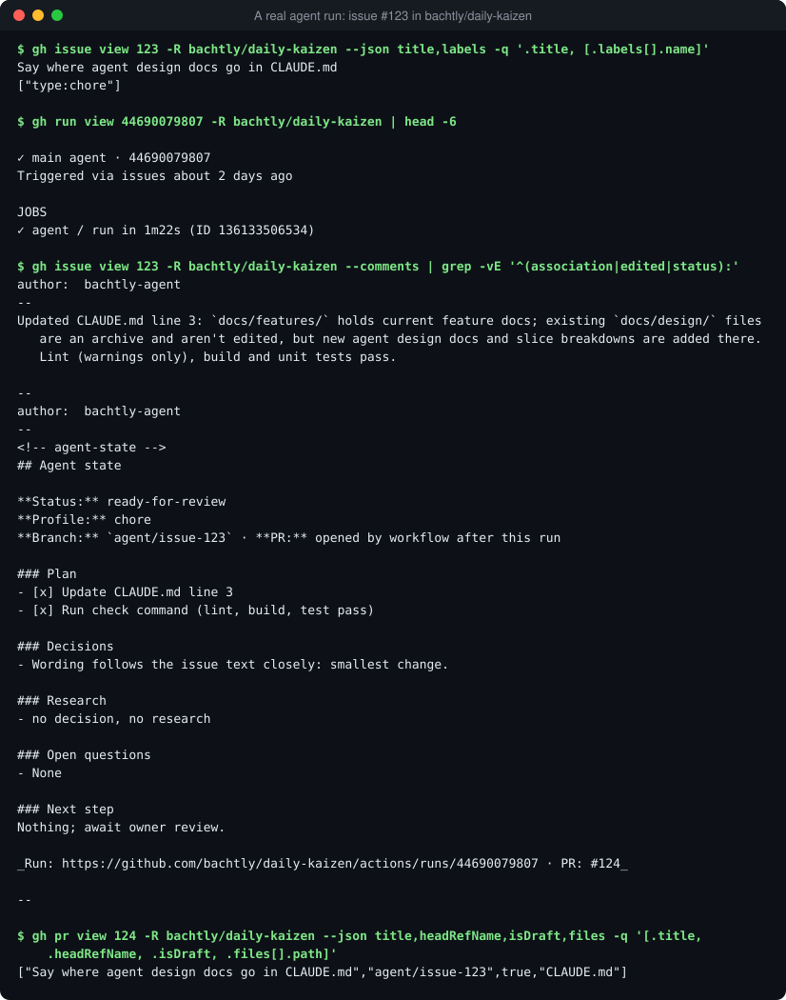
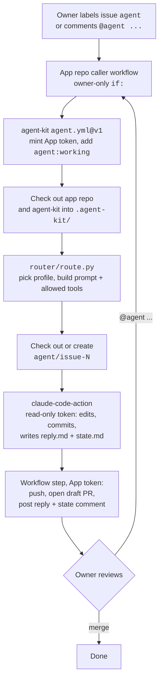
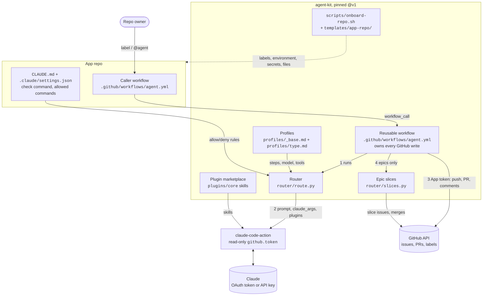
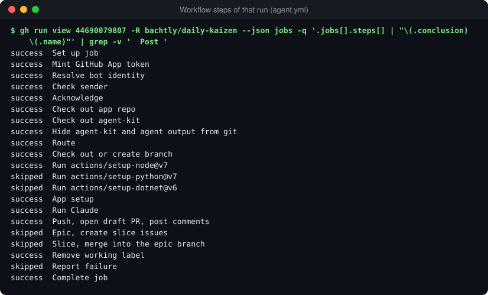
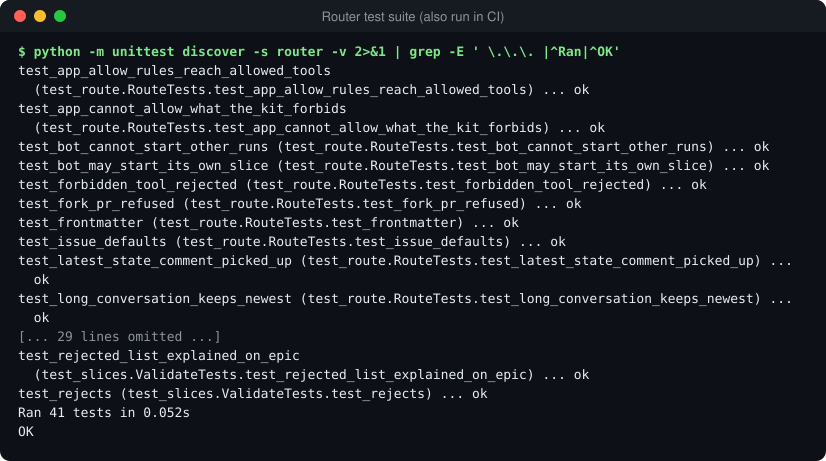
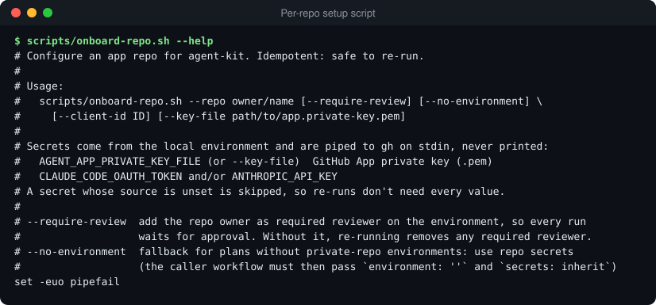

# agent-kit

**Label a GitHub issue `agent`, get a draft PR back.** An unattended issue-to-PR agent for your
repos, built on [`anthropics/claude-code-action`](https://github.com/anthropics/claude-code-action).

[](https://github.com/bachtly/agent-kit/actions/workflows/ci.yml)
[](https://github.com/bachtly/agent-kit/commits/main)
[](https://github.com/anthropics/claude-code-action)



<sub>Real `gh` output from [daily-kaizen#123](https://github.com/bachtly/daily-kaizen/issues/123) → [PR #124](https://github.com/bachtly/daily-kaizen/pull/124), captured from live commands.</sub>

## What it is

You label an issue `agent`. A GitHub Actions run picks it up, Claude works on a branch, the
workflow opens a draft PR, and the agent reports back with comments. To steer it, comment
`@agent ...` on the issue or the PR. There are no servers and no long-lived sessions: every run is
a fresh Actions job that rebuilds its context from the thread.

This repo holds the whole pipeline. Each app repo adds one ~15-line caller workflow plus its own
`CLAUDE.md` and `.claude/settings.json`.

## Features

| | |
|---|---|
| **Issue types** | `type:bug`, `chore`, `feature`, `mockup`, `epic`, each a profile with its own steps, model, turn cap and tool allowlist |
| **Design gates** | Features commit a design doc to the draft PR and wait for `@agent approve` before implementing |
| **Epics** | A big feature is split into slice issues that run in parallel and merge into one epic PR you review |
| **Mockups** | Storybook stories with mock data, one `Option A/B/...` story per open visual question |
| **Continuity** | A state comment (`<!-- agent-state -->`) carries plan, decisions and next step from run to run |
| **Locked down** | The agent only gets a read-only token; workflow steps do every write with a short-lived GitHub App token |
| **Owner-only** | Only the repo owner's label or `@agent` comment starts a run; only owner and bot comments reach the prompt |
| **Shared skills** | `plugins/core` ships as a Claude Code plugin marketplace: design, slicing, mockups, web research, state |

## Quickstart

Once the GitHub App and secrets exist ([setup](docs/setup.md), or ask Claude Code in this repo to
"onboard owner/repo"), add this caller to the app repo as `.github/workflows/agent.yml`
(from [`templates/app-repo`](templates/app-repo/.github/workflows/agent.yml)):

```yaml
name: agent
on:
  issues:
    types: [labeled]
  issue_comment:
    types: [created]
permissions:
  contents: read
jobs:
  agent:
    # Owner events, plus the App starting a slice run of an epic (the kit re-checks it is this App).
    if: >-
      (github.event.sender.login == github.repository_owner &&
       (github.event.label.name == 'agent' || contains(github.event.comment.body, '@agent'))) ||
      (github.event.sender.type == 'Bot' && github.event.label.name == 'agent' &&
       contains(github.event.issue.labels.*.name, 'type:slice'))
    uses: bachtly/agent-kit/.github/workflows/agent.yml@v1
    secrets: inherit
    with:
      app_client_id: ${{ vars.AGENT_APP_CLIENT_ID }}
      # node_version: "24"
      # setup_command: npm ci
```

Then open an issue, add `type:chore` and `agent`, and watch for a draft PR from `agent/issue-<N>`.

## How it works



Each run is stateless. The router reads the issue/PR body, the latest state comment, owner and bot
comments and inline review comments, so the next run picks up where the last one stopped. Full
lifecycle, security model and limits: [docs/how-it-works.md](docs/how-it-works.md).

## Architecture



| Piece | Stack | Runs on |
|---|---|---|
| Reusable workflow | GitHub Actions (`workflow_call`) | GitHub-hosted `ubuntu-latest`, in the app repo's Actions |
| Router, slices | Python 3, stdlib only, `gh` CLI | The same job |
| Agent | `anthropics/claude-code-action@v1`, Claude Code plugins | The same job, in the app checkout |
| Auth | GitHub App token (1 h) for writes, `github.token` (read) for the agent | Secrets in an `agent` environment, default branch only |
| Setup | Bash + `gh` (`scripts/onboard-repo.sh`) | Your machine, once per app repo |

## Gallery

<details>
<summary>Workflow steps, tests and setup script (real output)</summary>

The steps of the run above, as recorded by GitHub Actions. Steps for epics, slices and failures were skipped:



The router test suite (41 tests, also run by CI):



The per-repo setup script:



</details>

## Docs

- [docs/setup.md](docs/setup.md): one-time GitHub App and credentials setup, per-repo secrets, the no-environment fallback
- [ONBOARDING.md](ONBOARDING.md): checklist for onboarding an app repo (or ask Claude Code: "onboard owner/repo")
- [docs/usage.md](docs/usage.md): what to label and comment, which type to pick, epics
- [docs/how-it-works.md](docs/how-it-works.md): run lifecycle, continuity, security model, limits, extending the kit
- [CLAUDE.md](CLAUDE.md): map of the repo and the invariants changes must keep

## Contributing

Run the same checks as CI (`.github/workflows/ci.yml`) before a PR:

```sh
python -m unittest discover -s router -v && shellcheck scripts/*.sh && actionlint
```

Add a router test for every behaviour change, and read the invariants in [CLAUDE.md](CLAUDE.md).
Changes reach app repos when the `v1` tag moves; breaking changes to the caller interface need
`v2` and a migration note here.

## License

No license file yet, so default copyright applies. Ask the owner before reusing the code.
